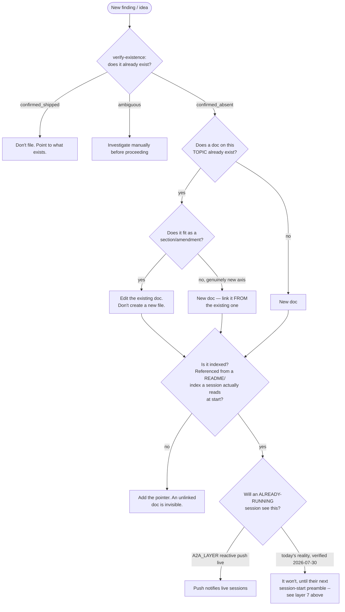

# Freshness Discipline (DOC-059, META-114)

> Filed 2026-05-27 by `curator-opus-shepherd-2026-05-23` after a session that surfaced **three distinct stale-tree false-positives** within 4 hours. The lessons here are concrete, not theoretical — each anti-pattern below has a date-stamped precedent from that session.

## TL;DR

When you think "this file is missing" or "this gap doesn't have AC" or "this primitive doesn't exist," **the failure mode is almost certainly your local state, not the world's state**. Default to checking `origin/main` and the canonical DB, not your shell's `ls`.

Three commands replace three classes of mistake:

| Mistake | Diagnostic | Fix |
|---|---|---|
| "File X doesn't exist" via local `ls` | `git ls-tree origin/main path/to/X` | Pull main; or use the [`verify-existence`](../../.claude/skills/verify-existence/SKILL.md) skill |
| "Gap X has TODO ACs" | `chump gap show X` against state.db | `chump gap set X --acceptance-criteria ...` (state.db is the only truth; `sync --pull` retired, INFRA-8193) |
| "Binary doesn't support new flag" | `chump --build-info` vs `git log -1 --format=%H origin/main` | `cargo install --path . --force` |

When in doubt, run the per-session freshness preamble first:

```bash
bash scripts/coord/freshness-preamble.sh
```

Exits 0 (FRESH), 1 (STALE), or 2 (CRITICAL_STALE). Read [META-115](../gaps/META-115.yaml) for the full classification rule.

## The 7 staleness layers

Inherited from [META-114](../gaps/META-114.yaml). Each layer has a distinct freshness signal and a distinct fix.

| # | Layer | How it goes stale | Today's fix |
|---|---|---|---|
| 1 | **git main** | local checkout not pulled | `freshness-preamble.sh` checks `git rev-list HEAD..origin/main --count`; ≥50 commits behind → CRITICAL_STALE |
| 2 | **state.db** | `chump gap reserve` writes TODO ACs; YAML edits don't sync back (by design since INFRA-8193) | edit the store: `chump gap set`; `chump gap sync --push` refreshes the mirror |
| 3 | **chump binary** | new CLI features ship to main faster than `cargo install` runs locally | `freshness-preamble.sh` checks binary mtime; INFRA-2054 adds `--rebuild-if-stale` gate |
| 4 | **launchd plists** | new daemon shipped; operator hasn't reloaded; or plist installed without `StartInterval` | `chump cron health` (META-110/INFRA-2046) audits every Chump plist |
| 5 | **YAML gaps** | atomic Write edits don't propagate to state.db | export-only mirror (INFRA-8193): never hand-edit; `chump gap sync --push` |
| 6 | **active leases / fleet-registry** | local `.chump-locks/*.json` doesn't propagate cross-machine | NATS-primary path ([META-061](../gaps/META-061.yaml)) — not yet shipped; file-fallback only today |
| 7 | **docs (CLAUDE.md, playbooks)** | doctrine evolves mid-session; agents don't re-read | A2A peer broadcasts (INFRA-1932 Pattern 0) surface doctrine updates fast — **today's honest state (verified 2026-07-30): the NATS broker is genuinely live and both A2A flags are ON at the launchd level, but the end-to-end proof (`consensus_result` firing) has never happened once — see [RESILIENT-212](../gaps/RESILIENT-212.yaml). Don't assume this fix is load-bearing yet; verify.** |
| 8 | **new-content placement** ("Drift Doctor", [DOC-076](../gaps/DOC-076.yaml)) | a finding gets written as a brand-new doc/gap without checking whether it already exists, or belongs in an existing doc as a section | run [§ The doc-placement decision](#the-doc-placement-decision-layer-8) below before creating any new `.md` file |

## The verify-at-source rule

**Always check `origin/main` via `git ls-tree` (or the [`verify-existence`](../../.claude/skills/verify-existence/SKILL.md) skill), never local `ls`, before filing a "file missing" gap.**

### Why

Long-running curator sessions drift 40+ commits behind `origin/main`. New files added by other curators' merged PRs are invisible to local `ls` until you `git pull`. A `ls` that returns "no such file" tells you about your CHECKOUT, not the REPO.

### Concrete example (2026-05-27, today)

A shepherd session noticed `bash scripts/coord/recovery-queue-emit.sh` returned `no such file`. Filed INFRA-2047 to create the wrapper. Wizard independently ran the same `ls`, got the same answer, agreed the file was missing. Then a deliberate verify via `git ls-tree origin/main` showed `100755 blob c9a075ed7b86c1c9837b975fa2277e8163a93d77 scripts/coord/recovery-queue-emit.sh` — the file IS on `origin/main` (added by INFRA-1993 PR #2599, 4h prior). Both curators had local checkouts ≥48 commits behind.

INFRA-2047 was correctly closed `superseded`. The lesson: **two stale curators agreeing on a missing file is still both being wrong about the same thing.**

### Decision rule

| Situation | WRONG | RIGHT |
|---|---|---|
| Filing a gap titled "X is missing" | `bash -c "ls path/to/X"` returns 1, file gap | `git ls-tree origin/main path/to/X` shows blob → don't file; OR invoke `verify-existence` skill which checks both |
| Discovering a gap has TODO ACs | Concluding the AC is missing | `chump gap show <ID>` against canonical state.db AND `cat docs/gaps/<ID>.yaml`; fix in the store with `chump gap set` (`sync --pull` retired, INFRA-8193) |
| Operator reference to a primitive | Assuming the primitive doesn't exist if local `which` fails | `git ls-tree origin/main` + check `Cargo.toml` workspace members + check `scripts/launchd/com.chump.*.plist` |
| Operator says "this binary should have flag Y" | Assuming the flag isn't shipped if local binary doesn't recognize it | `chump --build-info` shows local binary's git SHA; compare to `git log -1 --format=%H origin/main`; rebuild via `cargo install --path . --force` if drift |
| A claim claims a file path that doesn't seem to exist | Concluding the claim is broken | The lease's `paths:` field is what the claimer INTENDS to touch in the worktree, not a precondition |
| Active sibling lease shows in hook digest | Assuming you can ignore it | Skip ANY work that overlaps active sibling-lease paths; re-check digest before every commit |

## Anti-patterns (each with a real 2026-05-27 precedent)

### Anti-pattern 1: `bash ls` against local-stale-tree

**Symptom**: `ls path/to/X` returns 1 (no such file).

**False conclusion**: file is missing on origin/main.

**Real cause**: local checkout behind origin/main.

**Fix**: `git ls-tree origin/main path/to/X` OR `verify-existence` skill. Pull main if you need the file locally.

**Precedent**: today, `recovery-queue-emit.sh` phantom-missing.

### Anti-pattern 2: `chump gap reserve` creating TODO ACs that subsequent edits don't reconcile

**Symptom**: `chump gap show <ID>` shows `acceptance_criteria: ["TODO: ..."]` even though you wrote concrete AC via YAML edit.

**False conclusion**: the AC didn't save.

**Real cause**: `chump gap reserve` writes TODO ACs to state.db on creation. Subsequent `Write` tool edits to `docs/gaps/<ID>.yaml` are atomic but don't auto-propagate to state.db. `chump gap set --acceptance-criteria` uses a pipe-delimited input that breaks on common chars (INFRA-2022).

**Fix**: edit the store (`chump gap set <ID> --acceptance-criteria ...`), never the YAML. INFRA-8193 retired `chump gap sync --pull`: the YAML mirror is export-only.

**Precedent**: today, shepherd direct-sqlite-UPDATE'd state.db **6+ times** as workaround.

### Anti-pattern 3: chump binary 2.8h old + new CLI flag missing

**Symptom**: `chump --temp` returns full multi-line health output, not the documented `COLD | WARM | HOT` enum.

**False conclusion**: the `--temp` flag wasn't implemented.

**Real cause**: feature was on origin/main but local binary built before that commit.

**Fix**: `chump --build-info` (when INFRA-2054 ships) shows local SHA; compare to origin/main; `cargo install --path . --force` to rebuild.

**Precedent**: today, [INFRA-2032](../gaps/INFRA-2032.yaml) almost filed claiming the flag is wrong.

### Anti-pattern 4: launchd plist on disk but never fires due to missing `StartInterval`

**Symptom**: daemon process never runs even though the plist exists.

**False conclusion**: launchd is broken; the daemon is dead.

**Real cause**: plist loaded successfully but lacks `StartInterval` or `StartCalendarInterval`, so launchd never schedules a fire.

**Fix**: `chump cron health` (INFRA-2046 when it ships) audits every Chump plist for this class. Until then, `plutil -p ~/Library/LaunchAgents/com.chump.NAME.plist | grep -E 'StartInterval|StartCalendarInterval'`.

**Precedent**: [INFRA-1929](../gaps/INFRA-1929.yaml) — the prune-worktrees plist had this exact bug; 321 orphan worktree dirs accumulated; 31GB disk consumed before detection.

## The per-session freshness preamble

`scripts/coord/freshness-preamble.sh` (META-115) runs at session-start. Four checks:

1. `git fetch origin main` then `commits-behind = git rev-list HEAD..origin/main --count`
2. `binary-age = unix-now - mtime(which chump)`
3. `chump cron health` (fail-soft if unavailable)
4. `chump fleet-bootstrap --check` exit code (fail-soft if unavailable)

Classification:

- **FRESH**: `commits-behind ≤ 15` AND `binary-age ≤ 3600s` AND cron-health pass
- **STALE**: `commits-behind 16-50` OR `binary-age 1-4h` OR any cron-health warn
- **CRITICAL_STALE**: `commits-behind > 50` OR `binary-age > 4h` OR any cron-health critical

Exit codes match the state (0/1/2).

`scripts/coord/freshness-gate.sh` is the refusal wrapper: chain it with `&&` before any MUTATE-class operation. CRITICAL_STALE exits non-zero, refusing the downstream operation. Bypass via `CHUMP_ACCEPT_STALE=1` env var; the bypass emits an audit-trail ambient event.

Both ship with META-115. See its acceptance_criteria for the full env-tunable threshold list.

## When to use `verify-existence` skill

The [`verify-existence`](../../.claude/skills/verify-existence/SKILL.md) skill is the canonical surface for "does this thing exist on origin/main?" It checks (a) `git ls-tree origin/main`, (b) symbol-grep across crates, (c) endpoint registration, (d) script + manifest entry. Returns one of:

- `confirmed_shipped`: multiple positive signals; the thing exists, you're stale
- `confirmed_absent`: no signals across all checks; the thing genuinely doesn't exist
- `ambiguous`: single signal — investigate manually

**Use it before filing any "X is missing" gap.** This is mandatory per CLAUDE.md → mandatory pre-flight section (which links here).

## The doc-placement decision (layer 8)

> **"Drift Doctor"** — [DOC-076](../gaps/DOC-076.yaml). `verify-existence` (above) answers "does this thing already exist." This section answers the DIFFERENT question that comes right after: given a new finding that's genuinely new, where does it go — new file, or does an existing doc already own this topic? Nothing owned this decision before DOC-076; `docs/process/CUSTODIAN_BLUEPRINT.md` even names the resulting symptom without fixing it ("discoverability is via grep over 70 process docs").



### Worked validation (the AC's own test set)

The gap's acceptance test asks whether this flowchart's output matches independent human judgment on a real case set. One exists already: this session (2026-07-30) hit exactly seven "should I file something new" decisions before this doc existed to guide them, decided by direct human/agent judgment in the moment. Running the flowchart against each after the fact:

| Finding | Flowchart says | What actually happened | Match? |
|---|---|---|---|
| Broader security scanning for delivered tools | Topic doc exists (`COTG-6.3`/`INFRA-3507` already covers secret-sweep) → amend | Amended `INFRA-3507`'s AC | ✅ |
| Cost gating per customer vision | Topic doc exists (`COTG-0.2`/`INFRA-3481` go/no-go) → amend | Amended `INFRA-3481`'s AC | ✅ |
| Rollback on customer promote | Topic doc exists (`COTG-5.1`/`INFRA-3502`, just amended with stage/promote) → amend | Amended `INFRA-3502`'s AC | ✅ |
| Vision-intake privacy | Topic doc exists (`COTG-0.1`/`INFRA-3480` intake) → amend | Amended `INFRA-3480`'s AC | ✅ |
| Verifier red-team | `verify-existence`-style check found `RED_TEAM_VERIFICATION.md` but confirmed it's a different topic (gap-stall claims, not judgment-organ testing) → new | Filed `CREDIBLE-177` | ✅ |
| consensus_result never firing | Genuinely new diagnostic, no existing doc/gap owns it → new | Filed `RESILIENT-212` | ✅ |
| Doc-placement logic itself | Genuinely new axis, `FRESHNESS_DISCIPLINE.md` exists but only covers staleness-of-existing, not placement-of-new → new (but linked FROM the existing doc, per the H branch above) | Filed `DOC-076`, wired here rather than as a disconnected new doc | ✅ |

7/7 — encouraging, though N=7 from one session judged by the same reasoning that designed the flowchart is a weak test. Re-run this table against the next batch of real findings from a *different* session before trusting it further.

## Cross-references

- [META-114](../gaps/META-114.yaml) — umbrella for the freshness discipline cluster
- [META-115](../gaps/META-115.yaml) — per-session source-freshness preamble (the script)
- [INFRA-2053](../gaps/INFRA-2053.yaml) — chump gap sync (state.db ↔ YAML reconciliation)
- [INFRA-2054](../gaps/INFRA-2054.yaml) — chump --rebuild-if-stale binary self-update gate
- [META-116](../gaps/META-116.yaml) — Sonnet hang-detection (a related discipline)
- [INFRA-2022](../gaps/INFRA-2022.yaml) — `chump gap set` AC-overwrite bug (the prevention; sync is the recovery)
- [INFRA-1929](../gaps/INFRA-1929.yaml) — prune-worktrees plist missing StartInterval (anti-pattern 4 precedent)
- [CLAUDE.md → mandatory pre-flight](../../CLAUDE.md#mandatory-pre-flight-every-session-before-any-work)
- [`verify-existence` skill](../../.claude/skills/verify-existence/SKILL.md) — canonical existence check

## How to extend this doc

When a new staleness class is discovered (e.g. NATS-state lag, multi-machine fleet-registry drift, IDE LSP cache staleness), add:

1. A row to the **7 staleness layers** table (it may become 8+)
2. An anti-pattern subsection with a date-stamped precedent
3. A decision-rule entry to the table
4. A cross-reference to whatever new gap captures the fix

Keep precedents concrete. Generic best-practice framing ages badly; date-stamped real events are why this doc exists.
